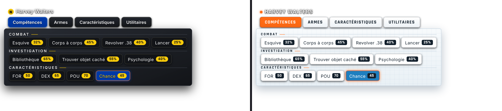
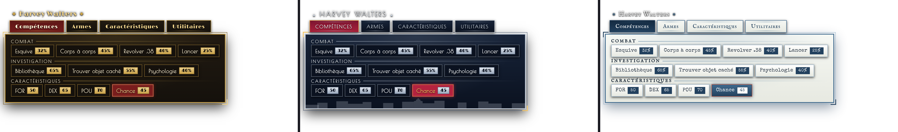

# Token Action HUD – Thèmes L'Appel de Cthulhu

Cinq styles pour [Token Action HUD](https://foundryvtt.com/packages/token-action-hud-core), dans l'esprit des années 1920 et de *L'Appel de Cthulhu* :

- **Années 20 (Art Déco)** : noir et or, enseignes de cinéma ;
- **New York années 20** : bleu nuit, chrome, silhouette de Manhattan, néon rouge ;
- **Par-delà les Montagnes Hallucinées** : carnet d'expédition polaire, papier givré, encre bleu marine ;
- **New York 2026** : verre fumé, pastilles jaunes du métro, onglet ouvert bleu MTA ;
- **Antarctique 2026** : tablette de station polaire, blanc glacier, orange sécurité.



Les mêmes thèmes existent dans [Combat Cthulhu HUD](https://github.com/magisterphamtom/combatcthud) et [CoC7 – Cartes de chat thématiques](https://github.com/magisterphamtom/coc7-cartes-chat), qui peut les appliquer partout d'un seul réglage.



## Ce que change le thème Années 20

- Onglets façon enseigne de cinéma (police Limelight, filets dorés), onglet ouvert en rouge velours.
- Panneaux déroulants encadrés d'un double filet or, avec coins Art Déco.
- Boutons d'action en Poiret One, scores dans un petit cartouche doré, munitions en rouge.
- Titres de sections en capitales espacées, soulignés d'un filet doré.
- Images d'objets légèrement sépia (couleurs au survol), nom du personnage en titre de film muet.
- Infobulles du HUD assorties.

Le thème ne change que l'apparence : aucune action, aucun réglage de Token Action HUD n'est modifié. Il fonctionne avec tous les systèmes, mais il a été pensé pour **Token Action HUD CoC7**.

## Utilisation

1. Installez et activez le module (il nécessite **Token Action HUD Core 2.1** ou plus).
2. **Paramètres › Configurer les paramètres › Token Action HUD Core › Style** : choisissez **« Années 20 (Art Déco) »**, **« New York années 20 »** ou **« Par-delà les Montagnes Hallucinées »**, **« New York 2026 »** ou **« Antarctique 2026 »**.

Le style de Token Action HUD est un réglage personnel : chaque joueur choisit le sien.

**Pour toute la table :** le Gardien peut choisir un **« Thème imposé à toute la table »** dans les réglages de ce module. Il s'applique aux joueurs connectés et à chaque connexion. Si vous utilisez la synchronisation du module *CoC7 – Cartes de chat thématiques*, laissez plutôt ce réglage sur « Laisser chacun choisir » et imposez le thème depuis le module de chat.

## Installation

Dans **Modules complémentaires › Installer un module**, collez ce lien de manifeste :

```
https://github.com/magisterphamtom/tah-annees-20/releases/latest/download/module.json
```

## Compatibilité

Foundry VTT 13 et 14 (vérifié en 14.368), Token Action HUD Core 2.1.2.

## Crédits et licence

- Thème : **magisterphamtom** — licence [CC BY 4.0](LICENSE).
- Feuille de structure de Token Action HUD Core : **Larkinabout** (CC BY 4.0), reprise sans modification dans `less/vendor/`.
- Polices : Limelight, Poiret One, IM Fell English, Inter et Rajdhani (SIL OFL 1.1), Special Elite (Apache 2.0) — licences dans `fonts/`.

Pour modifier un thème : la mise en forme commune est dans `less/_theme.less`, chaque palette dans `less/tah-<thème>.less`. Compilez avec `npx lessc less/tah-annees20.less styles/tah-annees20.css` (idem pour `newyork` et `montagnes`).
